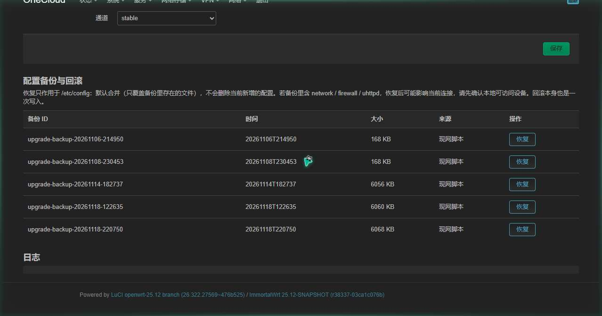

# oc-upgrade-luci（V0 骨架）

OneCloud 专用在线升级 LuCI 应用。范围只针对 OneCloud，**不承诺跨机型**；「通用」只指跨用户、跨仓库、跨自编译固件。


## 构建与产物（CI）

`.github/workflows/build-packages.yml` 在公开仓的 Actions 里跑，不占私有额度：

- 下载 OpenWrt **25.12.0 x86/64 SDK**，把本仓 `package/` 注入 `package/oc-upgrade`；
- `feeds update/install` 后逐个 `make package/oc-upgrade/<pkg>/compile`；
- 只收集本仓 5 个包，数量不为 5 直接失败；产物上传为 artifact `onecloud-upgrade-packages`。

**已跑通**（2026-11-23）：5 个 apk 全部产出，`arch:noarch`，合计约 29 KB：

| 包 | 大小 |
|---|---|
| fwupgrade-core | 16 KB |
| fwupgrade-provider-github | 3.6 KB |
| fwupgrade-flasher-onecloud | 2.2 KB |
| fwupgrade-flasher-dryrun | 1.5 KB |
| luci-app-onecloud-upgrade | 5.6 KB |

> SDK 日志里 `ucode` / `ucode-mod-fs` / `ucode-mod-uci` 会报 "has a dependency ... which does not exist"——那是 SDK 包索引不含基础包导致的告警，apk 的 `depend` 字段仍正确，设备上这些包已存在。

## 作为 OpenWrt feed 使用

本仓同时是一个 feed（5 个包都在 `package/` 下，`scripts/feeds` 会递归扫描）：

```sh
echo "src-git oc-upgrade https://github.com/2286927/luci-app-onecloud-upgrade.git" >> feeds.conf.default
./scripts/feeds update oc-upgrade
./scripts/feeds install -a -p oc-upgrade
# menuconfig: Utilities → fwupgrade-*；LuCI → Applications → luci-app-onecloud-upgrade
make package/luci-app-onecloud-upgrade/compile V=s
```

固件仓不再内嵌这些包；构建通过 feed 引用本仓。`PKGARCH=all`，产物与目标架构无关，但**最终发布物应由目标 buildroot 构建**（arm_cortex-a5_vfpv4），而不是 x86 SDK。

## 文档

- [安装与卸载](docs/安装与卸载.md)
- [救援指引](docs/救援指引.md)（失败判定、L1 回滚、线刷兜底）
- [兼容性](docs/兼容性.md)（支持范围与已验证矩阵）
- [固件接入](docs/固件接入.md)（feed 方式）
- [发布评估](docs/发布评估-20261123.md)

## 发布状态

`v0.1.0-rc1`：候选发布（pre-release）。已完成：主链路真机验证（含一次真实重刷）、结局判定修复、CI 打包（5 个 noarch apk）、apk 真机安装纳管、6 条关键故障注入、演练/强制开关与阶段进度、页面实测（保存开关、检测、备份表恢复/删除）、安装/救援/兼容文档。剩余：签名（V2）、i18n、完整 24 条故障矩阵（已做 9 条）。

## 下载

预发布产物：<https://github.com/2286927/luci-app-onecloud-upgrade/releases/tag/v0.1.0-rc1>（5 个 apk，`noarch`）。
打 tag 时 CI 会自动把 apk 附到 Release。

## Screenshots / 截图



（页面为深色主题；状态卡、演练/强制开关、备份表与诊断导出在同一页。）

## English

`luci-app-onecloud-upgrade` is a LuCI application for **OneCloud (Amlogic S805 / meson8b)** running ImmortalWrt 25.12. It wraps the device's built-in `upgrade` script with a configurable firmware source (any GitHub repo, static HTTPS directory or local file), version checks, dry-run mode, config backup/rollback and a redacted diagnostics bundle.

It is **not** a generic sysupgrade frontend: OneCloud has no `IMAGE/sysupgrade`, so the write path is delegated to the vendor script. Packages are `PKGARCH=all` (pure shell/ucode/JS), built in this repo's CI with the OpenWrt 25.12 SDK.

Docs are currently in Chinese: [install](docs/安装与卸载.md), [rescue](docs/救援指引.md), [compatibility](docs/兼容性.md).

## 现在有什么

| 包 | 作用 | 关键点 |
|---|---|---|
| `fwupgrade-core` | 状态机、单实例锁、清单解析、版本判定、日志、恢复判定 | 唯一的状态所有者；不含任何写盘逻辑 |
| `fwupgrade-provider-github` | GitHub Release / 静态 HTTPS / 本地文件 → 统一 `manifest.json` | release 内有 `manifest.json` 就用它；没有则按配置资产名合成（兼容模式） |
| `fwupgrade-flasher-onecloud` | 唯一写入实现，委托 `/usr/bin/upgrade` | 不自建写入逻辑：848 行脚本已吸收三次真实事故 |
| `fwupgrade-flasher-dryrun` | 只模拟、不写盘 | CI 与新设备接入验证用 |
| `luci-app-onecloud-upgrade` | LuCI 视图 + rpcd + ACL | 所有方法秒回，长任务只下发 job_id |

## 明确不做（V0）

sysupgrade 后端、ASU/ImageBuilder、批量/远程下发、无人值守定时升级、验签（字段保留，界面明示未启用）、「只下载不安装」入口。

## 目录

```
package/
  fwupgrade-core/                  # lib.sh / manifest.uc / worker.sh / fwupgradectl / init.d / config
  fwupgrade-provider-github/       # github.sh / static-https.sh / local-file.sh / ghrelease.uc
  fwupgrade-flasher-onecloud/      # onecloud.sh
  fwupgrade-flasher-dryrun/        # dryrun.sh
  luci-app-onecloud-upgrade/       # view / menu.d / acl.d / rpcd
tests/
  test_core.sh                     # 纯函数与状态层单测（开发机可跑）
  fixtures/manifest.sample.json    # 清单样例（已在设备上验证解析）
tools/
  probe_status.py                  # 只读取证：upgrade --status / 版本 / 脚本哈希
evidence/                          # 取证产物（不进仓库）
```

## 怎么测

```sh
# 1) 纯函数与状态/锁单测（不需要设备）
sh tests/test_core.sh

# 2) 只读取证（不写设备）
python3 tools/probe_status.py

# 3) 设备上冒烟测清单解析
#    把 manifest.uc 与 sample 传到 /tmp，然后：
#    ucode /tmp/fwu-manifest.uc < /tmp/fwu-manifest.json
```

## 关键契约

| 项 | 约定 |
|---|---|
| 状态文件 | `/opt/fwupgrade/state.env`（内部真值）+ `state.json`（派生，给 UI/rpcd） |
| 日志 | `/opt/fwupgrade/journal.log`，单次 ≤0.5 MB，超限就地截半 |
| 锁 | `/var/run/fwupgrade.lock`，内容 `pid boot_id phase`；`writing_boot` 即使 pid 已死也拒绝自动继续 |
| 退出码 | 0 成功 / 2 参数或占用 / 3 网络或身份 / 4 空间 / 5 下载 / 6 校验 / 7 未实现 / 8 状态 |
| 版本比较 | 优先 `build_ts`；退回 `YY.MM.DD_HH.MM.SS` 字符串比较（零填充，可直接比） |
| 写入 | 只调用 `/usr/bin/upgrade --check|--reboot`；boot 永远由它最后写 |

## 下一步（M1）

1. 在 dry-run 后端跑通 check → prepare → apply 的状态迁移，并补齐 `state.json` 的阶段字段。
2. GitHub provider 补 beta 通道、token、镜像回退（当前只有 stable + 匿名）。
3. 清单签名（B 级：清单与资产分属两个信任域，双 sha 交叉校验）。
4. LuCI 页面按真实交互再收敛（首版只做了状态卡与两个按钮）。

## M1 实测结论（2026-11-23 20:15）

已在现网机完成：包文件装到系统路径、rpcd 注册、ubus 方法调用、LuCI 页面渲染、页面按钮触发检测。全部为新增文件，未 enable init.d、未调用 `upgrade --reboot`。

| 项 | 结果 |
|---|---|
| `check`（local-file / dry-run） | 通过：identity=`target_ok+compatible_ok`，空间门槛 195 MiB / 可用 6144 MiB |
| `download` + `apply`（dry-run） | 通过：阶段迁移 writing_rootfs→resizing→writing_boot，终态 `idle/ok`，未写盘 |
| `check`（GitHub 真网络） | 通过：3.5s，合成清单 2 个资产，sha256 来自 release digest，版本归一为 `26.11.18_16.27.30` |
| `ubus call status/config_get/log_tail/check` | 全部 rc=0；`check` 异步受理并落状态 |
| LuCI 页面 | 渲染正常，状态卡/配置/两个按钮可用，检测按钮能触发真实检测 |

### 三个踩过的坑（都已在代码里改掉）

1. **LuCI 视图目录不能带连字符**。`view/onecloud-upgrade/overview.js` 会让页面永久停在「加载视图中…」；改成 `view/onecloud_upgrade/overview.js` 即正常。菜单 key 带连字符没问题，**只有 view 路径**不行。
2. **rpcd exec 插件的调用约定是 `list` / `call <method>`**，不是「无参枚举 + 方法名作为 argv[1]」。原来只处理无参，导致对象注册成功但方法列表为空（`ubus call` 返回 253）。
3. **同一个 rpcd 对象的并发调用会互相卡住**。视图 `load()` 用 `Promise.all([status, config_get])` 会一直转圈；改顺序 `.then()` 即正常。

### 备份管理（v0.1.0-alpha 起）

- 页面「配置备份与回滚」每行有 **恢复** 与 **删除** 两个操作。
- 删除走 `fwupgradectl forget --confirm <id> [--force]`；只允许删白名单根下的目录，路径解析后仍须在根内（防符号链接逃逸）。
- **最新一份是最后的救援料，默认拒绝删除**，必须显式 `--force`；页面上的删除按钮不带 force，所以删最新会被拒并提示走命令行。

### 安全默认

`/etc/config/onecloud-upgrade` 的 `dry_run` 默认为 `1`：即使清单指定真实 flasher，worker 也会强制走 dry-run。**只有显式 `uci set onecloud-upgrade.main.dry_run='0'` 才会真正写盘**。这是 T4 之前的默认闸门。

## V1 增量：备份可寻址 + L1 回滚（2026-11-23 20:40）

新增命令与方法：

```sh
fwupgradectl backups [--json]
fwupgradectl rollback --confirm <备份ID> [--replace] [--dry-run]
```

- **备份来源有两类**：本应用写入前自动产生的 `/opt/fwupgrade/backup/<job>/`，以及现网脚本已有的 `/opt/upgrade-backup-*/`（含 `config/` 与 `boot-p1.img.gz`）。
- **回滚只作用于 `/etc/config`**，默认 **merge**：只覆盖备份里存在的文件，不删除当前新增的配置；`--replace` 才整目录替换（高风险，需显式指定）。
- 每次回滚前先给当前配置打一份快照（`/opt/fwupgrade/rollback/<ts>-pre/`）；恢复后逐文件 `cmp` 校验，不一致即报错。
- 备份 ID 走白名单校验（只允许字母数字 `. _ -`，拒绝 `..` 与斜杠），路径穿越在参数层就被挡掉。

**设备实测**：

| 项 | 结果 |
|---|---|
| `backups` | 列出 5 个现网备份；11-14 之后的三个带 boot 备份，11-06/11-08 只有 config |
| `rollback --dry-run`（最新备份） | 37 个文件、4 个差异：`firewall`、`ksmbd`、`system`、`uhttpd` |
| 对 `/tmp` 副本执行真实 merge | 成功；副本文件数保持 39（本应用新增配置未被删除）；`network` 与当前一致 |
| LuCI | 备份表与「恢复」按钮渲染正常，含「可能影响连接」的风险提示 |

**没有做的事**：没有在现网 `/etc/config` 上执行真实回滚——那会把今天的 `firewall/system/uhttpd/ksmbd` 退回到 11-18 的值，属于 T4/T5 窗口内该做的事。单测用临时目录覆盖了 merge/replace 的真实写入路径（26/26 通过）。

## V1 收尾：诊断包（2026-11-23 20:43）

```sh
fwupgradectl diag        # 生成 /opt/fwupgrade/diag/fwupgrade-diag-<ts>.tar.gz
```

包内只有六项，且经过白名单与脱敏：

| 文件 | 内容 |
|---|---|
| `meta.txt` | 时间、主机名、oc-version、uptime、boot_id、phase/last_result、脚本与外壳 sha256、release、df、free |
| `state.json` | 当前状态快照 |
| `config.json` | 生效配置（token 只显示 none/configured） |
| `backups.json` | 可寻址备份列表 |
| `journal-tail.txt` | 应用日志末 200 行，`token=` / `Authorization=` 已打码 |
| `processes.txt` | 与 fwupgrade 相关的进程 |

**不含** `/etc/config` 任何文件内容、不含密码/私钥/完整 URL 查询串。设备实测：4 KB，6 个条目，`ubus call luci.onecloud-upgrade diag` 与页面按钮均可生成。

## T4 前置检查（2026-11-23 20:44）

| 项 | 结果 |
|---|---|
| SSH | 正常（auth none） |
| 串口 | COM4（CH340）可打开；只读 3 秒收到 0 字节（设备已启动且安静，正常）；未发送任何字节 |
| boot 备份完整性 | `gzip -t boot-p1.img.gz` 通过（6.0 MB） |
| 配置备份 | `/opt/upgrade-backup-20261118-220750/config` 37 个文件 |
| 控制台参数 | `console=ttyAML0,115200n8`，与串口速率一致 |
| 可升级版本 | **无**：最新 release 就是本机 `26.11.18_16.27.30` |

> 结论：链路与救援料都就绪，但**没有新版本可升**。T4 只剩「同版本强制重刷（--force）」这一个选项，属高风险且不产生版本变化，需明确授权后再做。

## T4 真实升级（2026-11-23 20:46–20:51，同版本 --force 重刷）

**结果：成功。** 版本号不变（本来就是最新），但完整走通了「备份 → 写 rootfs → 写 boot → 重启 → 引导 → 恢复判定」全链路。

| 时间 | 事件 |
|---|---|
| 20:45:40 | 串口 COM4 开始只读录制（全程未发送字节） |
| 20:46:05 | CLI 受理，进入 `writing_boot` |
| 20:49:57 | SSH 断开；串口出现 `## Booting kernel from Legacy Image` → `Starting kernel ...` |
| 20:50:29 | SSH 恢复，`boot_id` 由 `b518feba…` 变为 `c0c32a9b…`，uptime 0 分钟 |
| 20:51:34 | recover 判定完成：`idle / ok / mixed=N` |

**三方证据一致**：

- 设备侧脚本自己的记录：`reboot-ok ver=26.11.18_16.27.30 kv=6.12.116 sha-rootfs=6b465b839f4e sha-boot=da397ab79e13`
- 串口日志 438 行、23.7 KB，含 U-Boot 引导与内核启动，**无 panic / 无 Oops**
- 脚本自动备份：`/opt/upgrade-backup-20261123-204606`（boot 6,036,786 B + config 39 个文件）；应用自己的备份 `/opt/fwupgrade/backup/1795437962-29488`（20 KB）

**留存验证**：`/etc/config` 39 个文件（含本应用配置）、网络地址不变、dockerd 与 aria2 重启后恢复、`/opt` 与 `/root` 未被覆盖。收工后已复位：`force=0`、`dry_run=1`。

### T4 暴露并修掉的两个缺陷

1. **`upgrade --reboot` 会把重启丢进 setsid 子进程并立即返回 0**，worker 原来把这个 0 当成「写入成功但没重启」，误报 `failed/H1`。已改为 `boot_written/none`，把判定交给引导后的 recover。
2. **init.d 从未 enable**，所以重启后 recover 不会自动跑；已 `enable`，并让 recover 在 `idle/ok` 时清掉残留的 `mixed_state`。

### 一个新事实（已核实到根因）

刷机后 `oc-upgrade.sh` 从 51,430 B（`92d29dfb…`）变回 51,432 B（`337db7a3…`）。**两者代码完全相同，只差两行镜像加速列表**：

| | GH_MIRRORS | API_MIRRORS |
|---|---|---|
| 刷机后（= 镜像/仓库默认） | gh-proxy.org → gh.monlor.com → gh-proxy.com → ghproxy.imciel.com | gh-proxy.org → gh-proxy.com |
| 刷机前（11-20 04:18 设备侧改写） | gh.monlor.com → gh-proxy.org → ghproxy.imciel.com → ghfast.top | gh-proxy.com → gh-proxy.org |

证据：`/opt/up-mirror-maint.bak/oc-upgrade.sh.20261120-041835` 的 sha 正是 `337db7a3…`（改动前备份）；`/opt/up-mirror-maint.log` 记录了 11-20 04:17–04:18 的测速与重写；cron 为 `17 4 * * * /usr/bin/up-mirror-maint run`；该工具只改这两行。GH 行 91→89 字节、API 行等长，合计正好 −2 字节——这就是 51,430 与 51,432 的全部差异。

所以「覆盖」的后果只是**镜像顺序回到出厂默认**（含当次测速较慢的 gh-proxy.com、缺 ghfast.top），不影响校验与写入逻辑；下一次 cron 到期会重新测速重排。**脚本版本闸门仍必须保留**（确保接口语义匹配），但不能把它当成「代码版本回退」的证据。
